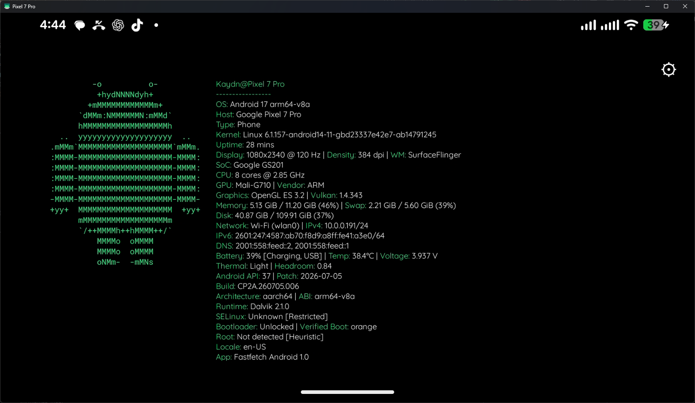
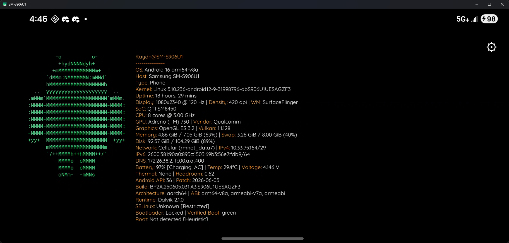
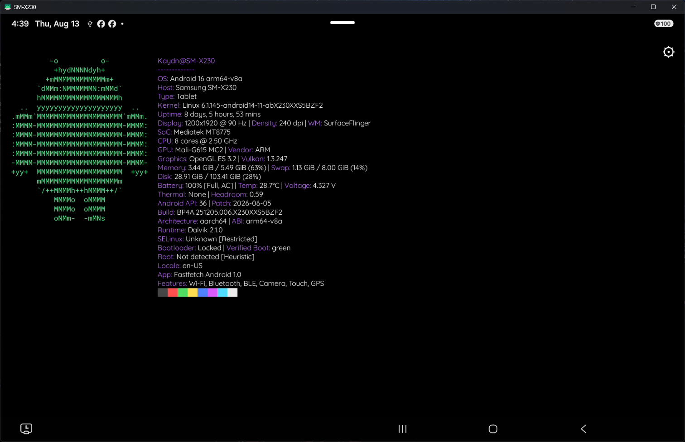

# Fastfetch Android

  <strong>Fastfetch-style system information, natively on Android.</strong>

  
  
  
  

Fastfetch Android brings detailed, Fastfetch-style device information to Android with a native app that works across phones, tablets, watches, TVs, VR headsets, emulators, and Android-on-PC setups.

It currently supports **Android 7.1 (API 25) and above** on `arm64-v8a`, `armeabi-v7a`, `x86`, and `x86_64`. For older devices, there's a separate [Legacy edition](#fastfetch-android-legacy) for **Android 4.1 to 7.0**.

> [!NOTE]
> **This project is vibe coded.** Most of the code was written with AI assistance (originally ChatGPT, now Claude), while I direct the work, test it on real devices, and check the results. Expect some rough edges, and please open an issue if something looks wrong.

## What's new in 1.2.1

- **Fixed a crash on round watches.** On round screens, opening settings crashed the app, and that included the setup screen on the very first launch.
- **Watches stay upright.** The app no longer asks watches for landscape, which could turn the whole screen sideways.

## What's new in 1.2

- **Fits tablets in portrait.** Android 16+ ignores the app's landscape lock on large screens, so tablets run it in portrait, and in 1.1 long lines got cut off. The layout now adapts to the space it has: it stays the same when everything fits (TVs, phones in landscape), uses a slimmer right margin when it doesn't, and puts the logo above the info in narrow windows like split screen.
- **Smoother updates.** Only the lines that changed are redrawn, and information that never changes is read once instead of on every refresh. On the onn Full HD Google TV stick, the slowest device I test on, a refresh now takes a median of under 8 ms to draw instead of 17 ms, and the background refresh uses about a third of the CPU it used to.
- Under the hood, the code was reorganized into smaller files. That doesn't change how the app looks or works.

## Features

Fastfetch Android can report information including:

- Device, Android version, build, kernel, uptime, architecture, and runtime
- Display resolution, refresh rate, density, and orientation
- SoC, CPU, GPU, OpenGL ES, Vulkan, RAM, swap, and storage
- Network information including IPv4, IPv6, and DNS when available
- Battery status, temperature, voltage, power source, and thermal information
- SELinux, bootloader state, Verified Boot, and root status
- Device features such as Wi-Fi, Bluetooth, camera, touch, and GPS
- Multiple output modes, including compact, detailed, minimal, and watch-friendly layouts
- Customizable modules, output order, fonts, Android logo visibility, and automatic refresh
- Copy and share support for generated system information

## Download / Installation

Check the [GitHub Releases page](https://github.com/Kaydn913/Fastfetch-Android/releases) for packaged builds.

To build it yourself, clone the repository, open it in Android Studio, and build the `app` module.

### Requirements

- Android 7.1 / API 25 or newer
- One of the following ABIs:
  - `arm64-v8a`
  - `armeabi-v7a`
  - `x86`
  - `x86_64`

### Fastfetch Android Legacy

For devices running **Android 4.1 to 7.0 (API 16 to 24)**, use **Fastfetch Android Legacy** instead. It's the same app, built from the same code, with fallbacks for older Android:

- Download `Fastfetch-Android-Legacy-v1.0.apk` from its [GitHub release](https://github.com/Kaydn913/Fastfetch-Android/releases/tag/legacy-v1.0).
- It installs as a separate app, next to the normal one.
- On Android 7.1 and newer it only shows a screen pointing to the normal app.
- Same ABIs as the normal app. Some details aren't available on old Android, like the security patch level below 6.0 and the DNS servers below 5.0.

To build it yourself, build the `legacy` module.

## Supported Platforms

| Platform | Status |
| --- | --- |
| Android phones | Tested |
| Android tablets | Tested |
| Wear OS watches | Tested |
| Android / Google TV | Tested |
| Android-based VR headsets | Tested |
| Android emulators | Tested |
| Android on PC | Tested |
| Android Automotive | Not tested yet |
| Android-based smart displays | Tested |

## Tested Devices

Fastfetch Android has been tested on 24 phones, 4 tablets, a VR headset, a watch, a TV stick, a smart display, 4 emulators, and 3 Android-on-PC setups.

See the **[full tested devices list](DEVICES.md)**.

## Screenshots

  
  
  

More screenshots are available in the **[full screenshot gallery](SCREENSHOTS.md)**, including Wear OS, Android TV, VR, emulators, Android on PC, and the settings interface.

## Known Limitations / Roadmap

- Virtual Master-specific emulator detection is not implemented yet.
- Native Android-on-PC installations and ChromeOS ARCVM can currently be classified as tablets.
- Some security or system information may be restricted by Android or the device manufacturer and may appear as unavailable or unknown.
- On very slow devices (like the onn Full HD Google TV stick), an info update still occasionally takes longer than one frame to draw, about once a minute in testing. It isn't noticeable on a static screen.
- More Android form factors and emulator environments can be added as they are tested.

## Bug Reports

If you find a bug, please report what happened and include your device model and Android version. Screenshots or logs are also helpful when available.

You can report bugs through the repository's [Issues page](https://github.com/Kaydn913/Fastfetch-Android/issues).

## Device Testing

Want to try Fastfetch Android on something that is not on the [tested devices list](DEVICES.md)? Go right ahead!

If it works, let me know what device or platform you tested it on and I can add it to the tested devices list.

## Suggestions / Contributions

Suggestions for new information, customization options, device support, and other improvements are always welcome.

Thanks for checking out Fastfetch Android!
